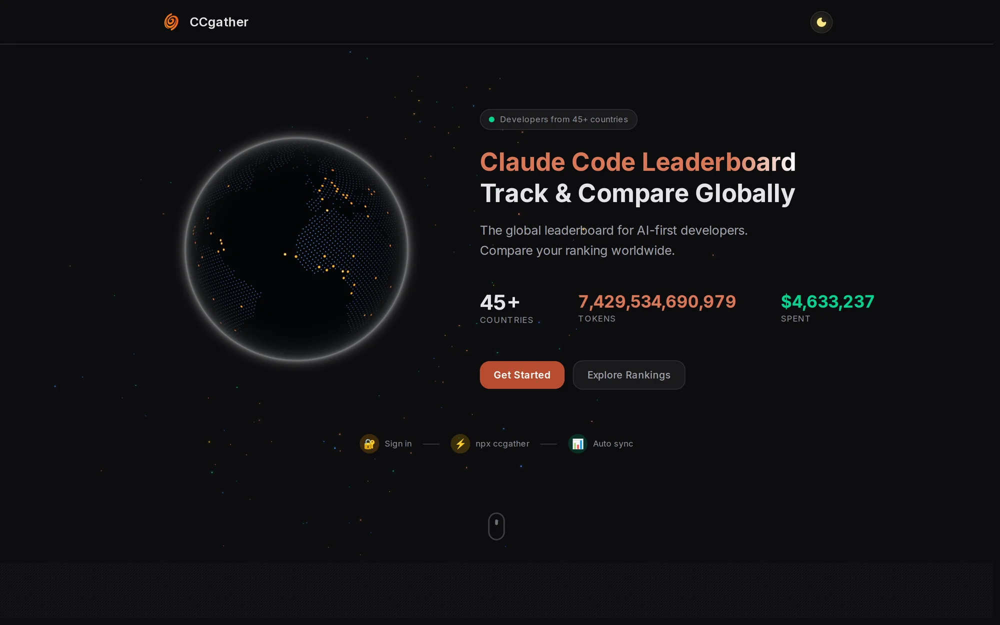
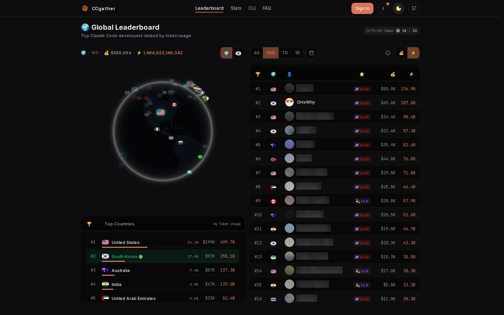
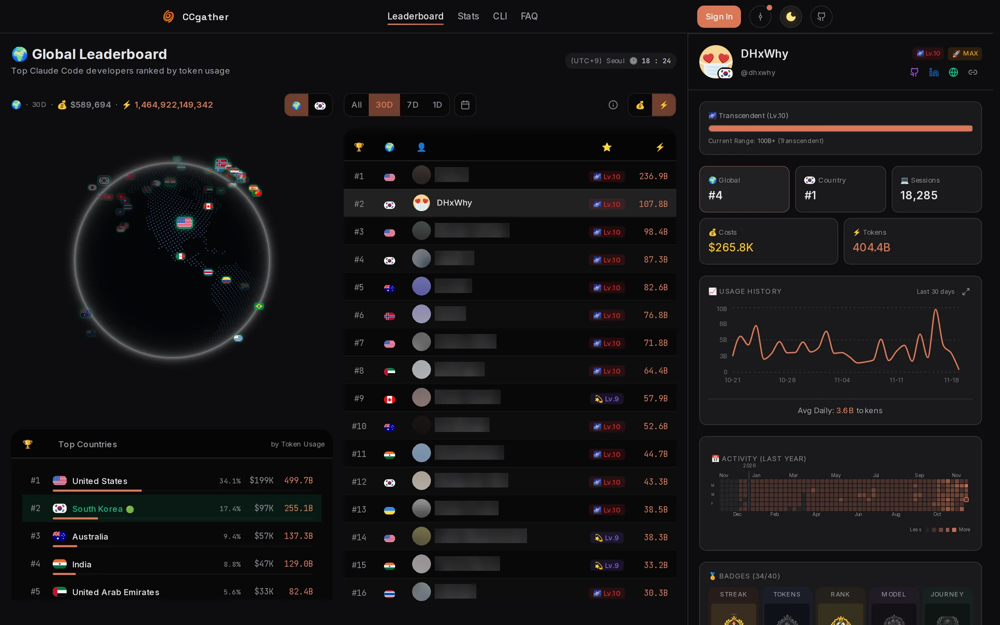
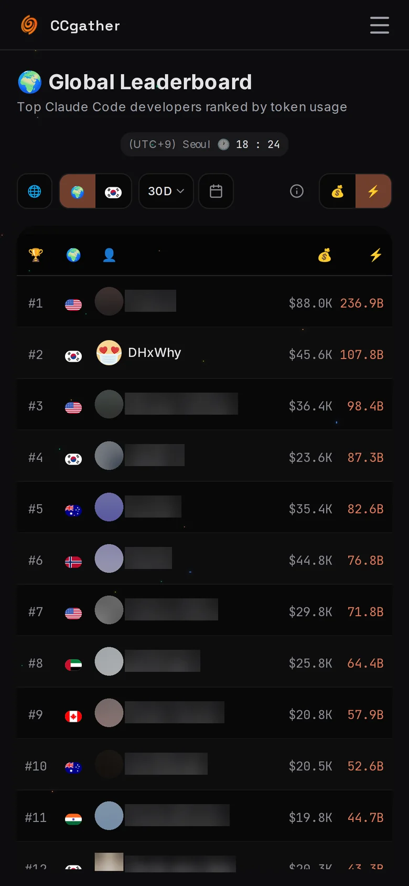
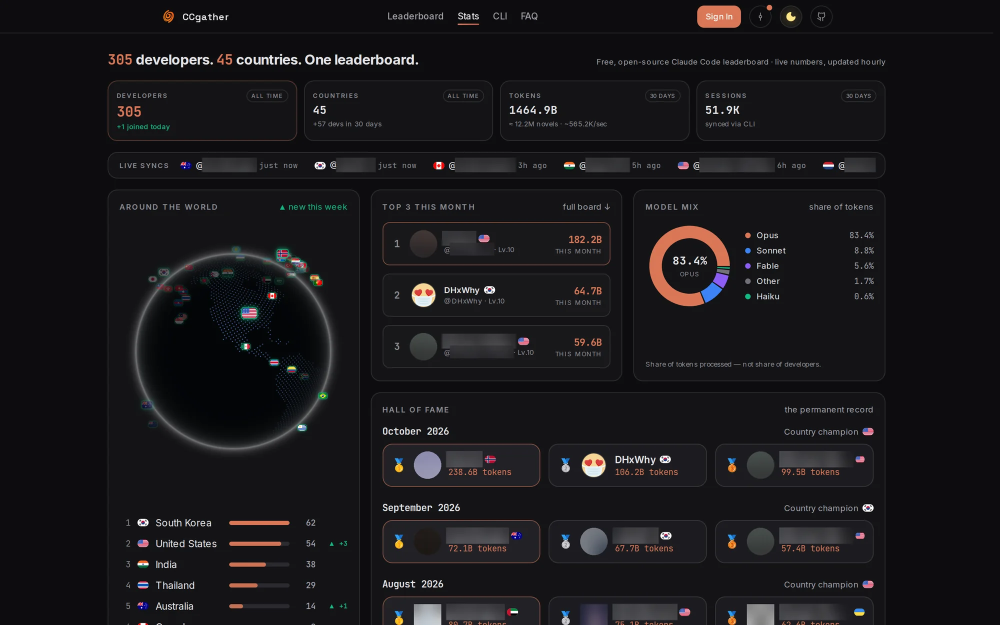
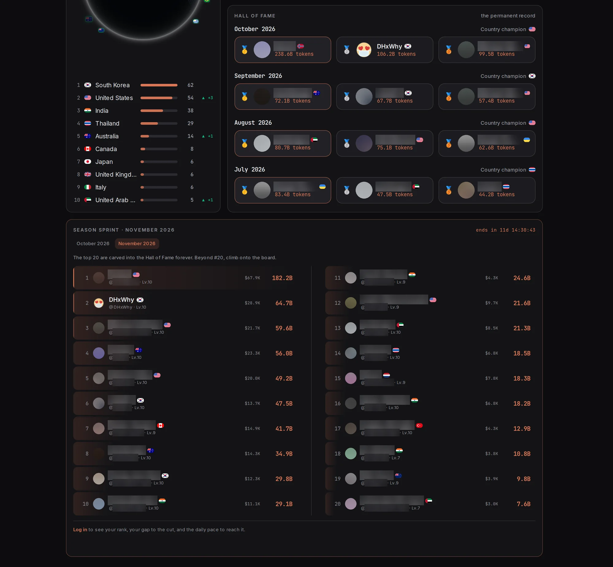

<div align="center">

# CCgather

**The open-source Claude Code usage leaderboard.**

Run `npx ccgather` to sync your Claude Code tokens and cost, then see where you rank — worldwide, in your country, and each month.

[](https://ccgather.com/stats)
[](https://ccgather.com/stats)
[](https://ccgather.com/stats)
[](https://www.npmjs.com/package/ccgather)
[](LICENSE)

[Leaderboard](https://ccgather.com/leaderboard) · [All-time ranking](https://ccgather.com/leaderboard?period=all) · [Live stats](https://ccgather.com/stats) · [Report a bug](https://github.com/DHxWhy/CCgather/issues)



</div>

---

> Claude Code clears its local logs after about 30 days, and your usage history goes with them.
> CCgather keeps your daily totals, because every token is a trace of your spirit of exploration.

## Quick start

```bash
npx ccgather@latest                  # sign in with GitHub, then submit
npx ccgather@latest autosubmit on    # submit once a day, automatically
```

Claude Code keeps about 30 days of local logs. CCgather keeps your daily totals after that, so your history stays.

---

## What you get

<table>
<tr><td width="200"><b>Claude Code leaderboard</b></td><td>Rank by tokens or cost over 1D, 7D, 30D or All — worldwide or in your country's league</td></tr>
<tr><td><b>Live stats</b></td><td>Developers, countries, 30-day tokens and sessions, and the model mix</td></tr>
<tr><td><b>Season Sprint</b></td><td>A monthly race; every finished month goes into the hall of fame</td></tr>
<tr><td><b>Your profile</b></td><td>Level, badges, a daily activity heatmap and your Claude plan. Share it as <code>ccgather.com/u/&lt;github-username&gt;</code></td></tr>
<tr><td><b>Daily auto-submit</b></td><td>Through your OS scheduler on Windows, macOS and Linux</td></tr>
<tr><td><b>Installable web app</b></td><td>Push notifications for your submit summaries and replies to your feedback</td></tr>
<tr><td><b>What's new</b></td><td>Every update, dated, inside the app</td></tr>
</table>



<table>
<tr>
<td width="64%"></td>
<td width="36%"></td>
</tr>
</table>





<sub>Other developers' names and avatars are blurred in these screenshots.</sub>

---

## How CCgather counts

- **Tokens** = input + output + cache writes + cache reads — the same definition [ccusage](https://github.com/ryoppippi/ccusage) uses. Cache reads are usually the largest part, so totals are far larger than on boards that leave cache out.
- **Each response once.** Claude Code writes one response as several lines; the CLI counts it once, at its largest line, as ccusage does.
- **Costs** use Anthropic's official API prices, synced hourly, including fast mode and 1-hour cache writes.
- **One project, one person.** One-way session fingerprints stop the same session from being submitted by two accounts.
- **Several machines** add up: each one submits its own usage, and a session is never counted twice.
- **Up to 2 submits per account per hour.**

---

## Privacy

- **Sent:** daily token and cost totals per model, session counts, one-way session fingerprints, a one-way device ID, the CLI version and your Claude plan type
- **Never sent:** prompts, conversations, code, file contents or file paths
- **Public:** your GitHub username, avatar and country on the leaderboard
- **Delete your account** in Settings — you can recover it for 7 days, then all of its data is deleted

---

## Levels and badges

Ten levels by total tokens:

| Level | Icon | Name | From |
| --- | --- | --- | --- |
| 1 | 🌱 | Novice | 0 |
| 2 | 📚 | Apprentice | 50M |
| 3 | ⚡ | Journeyman | 200M |
| 4 | 💎 | Expert | 500M |
| 5 | 🔥 | Master | 1B |
| 6 | 👑 | Grandmaster | 3B |
| 7 | 🌟 | Legend | 10B |
| 8 | 🏆 | Mythic | 30B |
| 9 | 💫 | Immortal | 50B |
| 10 | 🌌 | Transcendent | 100B |

40 badges in 6 categories: daily streaks (7), token milestones (7), rank (7), models (7), sessions and spend (7) and referrals, a GitHub star and auto-submit (5). By rarity: 12 common, 8 rare, 12 epic and 8 legendary.

---

## CLI

```bash
npx ccgather@latest
```

The menu:

<table>
<tr><th width="80">Menu</th><th width="180">Function</th><th>Description</th></tr>
<tr><td align="center">📤</td><td>Submit usage data</td><td>Scan and submit your Claude Code usage</td></tr>
<tr><td align="center">🔁</td><td>Auto-submit</td><td>Turn the daily automatic submit on or off, or change its time</td></tr>
<tr><td align="center">🌐</td><td>Open leaderboard</td><td>See the rankings in your browser</td></tr>
<tr><td align="center">⚙️</td><td>Settings</td><td>Sign in again, change account, choose data folders</td></tr>
</table>

### Scheduled Submit

```bash
npx ccgather@latest submit
```

Submits your usage without any prompt, so it can run from a scheduler. Log in once with `npx ccgather` first; `submit` never opens the login flow. It prints one timestamped result line and exits with:

<table>
<tr><th width="80">Code</th><th>Meaning</th></tr>
<tr><td align="center">0</td><td>Submitted</td></tr>
<tr><td align="center">1</td><td>Not logged in, no usage data, rate limited, or a network/server error</td></tr>
</table>

Claude Code keeps about 30 days of local data, so once a day is plenty. [Auto-submit](#auto-submit) (`npx ccgather@latest autosubmit on`) sets that up for you. To schedule it yourself instead:

```bash
# cron (macOS/Linux), every day at 21:17 — Node must be on cron's PATH
17 21 * * * npx --yes ccgather@latest submit >> ~/ccgather.log 2>&1

# Windows Task Scheduler (run in Command Prompt), every day at 21:17; a console window shows while it runs
schtasks /create /tn "CCgather submit" /sc daily /st 21:17 /tr "cmd /c npx --yes ccgather@latest submit >> \"%USERPROFILE%\ccgather.log\" 2>&1"
```

Pick a minute of your own rather than copying 21:17: everyone who keeps the example would reach the server in the same second. Task Scheduler skips a run on battery power by default, and both schedulers skip a run while the machine is asleep or off, so pick a time the machine is usually awake and plugged in.

A scheduler does not see the API key or cloud-provider variables your shell profile sets, so a submit it runs reports the Claude Code sign-in it can see (your claude.ai login, say), and your plan badge can switch between that and what a terminal submit reports. Auto-submit avoids this: its runs send no plan, so the badge follows your own submits.

### Auto-submit

Let the CLI set up the daily job for you, using your operating system's own scheduler:

```bash
npx ccgather@latest autosubmit on             # turn it on, or update/repair it
npx ccgather@latest autosubmit status         # what the scheduler has, and what the last run did
npx ccgather@latest autosubmit off            # remove it
npx ccgather@latest autosubmit on --at 21:30  # pick the time yourself
```

Without `--at` it runs every day at the time you turned it on plus five minutes (turn it on at 14:17 and it runs at 14:22), in your local time. People turn it on at different moments, so not everyone submits at once, and your machine is usually awake at that time. The main menu has the same thing as its second item, right under Submit usage data: `🔁  Auto-submit: OFF` turns it on, and `Auto-submit: ON · daily 14:23` offers Change time, Turn off and Back. If the machine was off at that time, the job catches up later (except with the Linux cron fallback, which skips that day); a run is skipped if you submitted in the 20 hours before it, so the first one may be. Running `on` again when it is already on refreshes the job and keeps its time. `status` shows what the scheduler has and what the last run did:

```
Auto-submit: ON
  Schedule:  daily at 14:23 (systemd user timer)
  Runs:      the newest ccgather release each day, via npx
  Last run:  2026-10-12 14:23 · skipped: submitted 10 minutes ago
  Next run:  2026-10-13 14:23
  Log:       journalctl --user -u ccgather-autosubmit
```

When the scheduler reports a run that failed before the CLI could record it (for example npx could not fetch the package), `status` shows a `Problem:` line.

When turning it on, you are offered the GitHub star prompt unless you have already starred.

<table>
<tr><th width="100">OS</th><th>What it creates</th><th>Log</th></tr>
<tr><td>Windows</td><td>Task Scheduler task <code>ccgather-autosubmit</code>, daily and at sign-in, also on battery, with no console window</td><td><code>%LOCALAPPDATA%\ccgather\autosubmit.log</code></td></tr>
<tr><td>macOS</td><td>LaunchAgent <code>com.ccgather.autosubmit</code>, daily and at login</td><td><code>~/Library/Logs/ccgather/autosubmit.log</code></td></tr>
<tr><td>Linux</td><td>systemd user timer <code>ccgather-autosubmit.timer</code>, or a marked crontab line where systemd user sessions are not available</td><td><code>journalctl --user -u ccgather-autosubmit</code>, or <code>~/.local/state/ccgather/autosubmit.log</code> with cron</td></tr>
</table>

The macOS setup is covered by tests but has not yet been run on a real Mac; Windows and Linux (systemd and cron) have. If the job misbehaves, `npx ccgather@latest autosubmit off` removes it.

Set up through `npx`, the job runs the newest ccgather release each day (`npx --yes ccgather@latest`), so upgrades reach it on their own; `--pin` keeps it on the version you set it up with, and running `on` again moves it. A global install runs its own copy and follows `npm install -g ccgather`; `--auto-update` makes even a global install run `ccgather@latest`. Jobs created through `npx` with v2.3.0 or v2.3.1 are pinned to that version: run `npx ccgather@latest autosubmit on` once to update them (an npm older than 9.6.5 keeps running a cached copy of `npx ccgather` without `@latest`).

- **macOS** may show a "Background Items Added" notification once.
- **Linux (systemd)** runs the job only while you are signed in and catches up at your next login. To run it while signed out, run `loginctl enable-linger $USER` yourself.

---

## FAQ

**Why are my totals so large?**
Cache reads count. Claude Code re-reads the same context many times, and those tokens are usually most of your total — ccusage counts them the same way.

**Why can Claude Code's `/stats` show more than CCgather?**
In our checks, `/stats` added a response's usage again for every content line in that response, while CCgather counts each response once.

**How often should I submit?**
Once a day is plenty — turn on auto-submit and forget it. Claude Code deletes local logs after about 30 days, so submit at least that often.

**Is it free?**
Yes. No paid tier, Apache 2.0, and the full source is in this repository.

---

## The story

I'm a non-developer from South Korea. I started vibe coding in August 2025, found Claude Code and spent 16+ hours a day exploring with it. Then I noticed Claude Code quietly deletes its logs after about 30 days, and the record of all that effort went with them. To me that record was not a score. Every token was another attempt, another experiment: a trace of the spirit of exploration. So I wanted to keep it. When the leaderboard I used stopped working and no fix came, I built my own, talking it through with Claude Code until I understood how the pieces fit.

CCgather went from its first commit on January 5, 2026 to its [Product Hunt](https://www.producthunt.com/products/ccgather) launch on February 2, 2026, about four weeks, with no marketing budget.

> **Token usage is not a measure of skill.** More tokens mean more attempts, more experiments, more exploration. The number shows your spirit of exploration and your passion.

**CC** = Claude Code · **Gather** = come together and collect.

---

## Tech stack

<table>
<tr><th width="140">Area</th><th>Technology</th></tr>
<tr><td><b>Web</b></td><td>Next.js 16, React 19, TypeScript, Tailwind CSS 4</td></tr>
<tr><td><b>Data and sign-in</b></td><td>Supabase (PostgreSQL), Clerk (GitHub OAuth)</td></tr>
<tr><td><b>UI</b></td><td>TanStack Query, Radix UI, Framer Motion, Recharts, Cobe (3D globe)</td></tr>
<tr><td><b>App</b></td><td>Installable PWA with Web Push</td></tr>
<tr><td><b>Tests</b></td><td>Vitest, Playwright</td></tr>
<tr><td><b>Hosting</b></td><td>Vercel</td></tr>
<tr><td><b>CLI</b></td><td>Node.js 18+, published to npm as <code>ccgather</code></td></tr>
</table>

---

## Contributors

Thank you to everyone who reports issues and sends pull requests. Code contributions so far:

- [@michael-huffaker](https://github.com/michael-huffaker) — subagent transcripts counted ([#33](https://github.com/DHxWhy/CCgather/pull/33)), `ccgather submit` for schedulers ([#34](https://github.com/DHxWhy/CCgather/pull/34)), workflow journals no longer counted as sessions ([#35](https://github.com/DHxWhy/CCgather/pull/35)), `ccgather autosubmit` ([#36](https://github.com/DHxWhy/CCgather/pull/36))
- [@JakeB-5](https://github.com/JakeB-5) — files with no session and no usage left out of the fingerprint ([#42](https://github.com/DHxWhy/CCgather/pull/42))

---

## Acknowledgements

<table>
<tr><th width="200">Project</th><th>Description</th></tr>
<tr><td><a href="https://github.com/ryoppippi/ccusage">ccusage</a></td><td>Claude Code usage analyzer that inspired our CLI and its counting (by <a href="https://github.com/ryoppippi">@ryoppippi</a>)</td></tr>
<tr><td><a href="https://github.com/shuding/cobe">cobe</a></td><td>3D globe library (by <a href="https://github.com/shuding">@shuding</a>, Vercel)</td></tr>
</table>

---

## License

Distributed under the Apache License 2.0. See [`LICENSE`](LICENSE).

<div align="center">

**Record. Track. Grow.**

[ccgather.com](https://ccgather.com)

</div>
